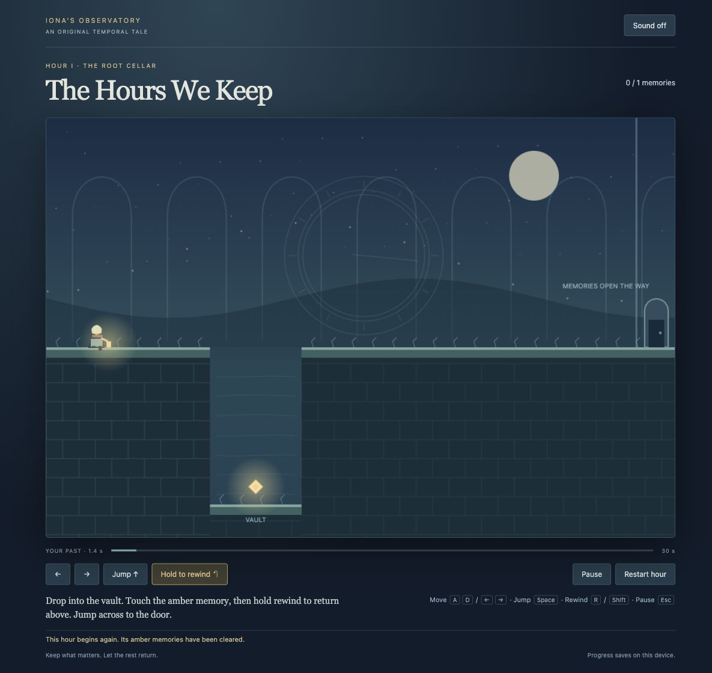

# The Hours We Keep

An original, complete four-hour puzzle-platformer about Iona, a lantern keeper returning to a drowned observatory. Inspired by time-manipulation puzzle design, with original characters, writing, procedural artwork and synthesized music. No copied assets, runtime network services, payments or public deployment.

**Blue reverses. Amber remembers.** Retrieve memories from deep vaults, rewind to escape, and take a different path. Later, bells remember their activation and keep bridges open across reversal. The final hour adds a blue pendulum that follows reversible world time. Each exit requires its memories and bell; walking and jumping alone cannot complete a room.

## Play locally

Node.js 24 and npm are required.

```sh
npm ci
npm run build
node scripts/launch.mjs 5191
```

Open **http://127.0.0.1:5191**. The launcher detaches a loopback-only server from the terminal for this Mac session. It refuses an occupied port and leaves existing servers alone. It installs no login or boot service. Logs: `play-server.log`; process ID: `.server.pid`. If the server is already running, just open the URL.

After a reboot or if the owned server stops, restart from this directory:

```sh
npm run build && node scripts/launch.mjs 5191
```

For foreground serving, use `npm start -- 5191`. Development: `npm run dev -- --port 5191 --strictPort` on a free port. Root `index.html` is a served Vite entry; direct `file://` opening is not supported.

## Controls

- Move: A/D or left/right arrows; jump: Space, W or up arrow.
- Hold R or either Shift to rewind; release to create a new branch.
- Escape pauses. Labeled pointer controls support holding, including rewind.
- Restart hour clears its memories, bell and history, preserving the current hour.
- Each restored hour advances through an explicit button; the ending offers replay.
- Sound is optional and begins only after pressing **Sound off** to enable it.

Recent reversal is bounded at 1,800 snapshots (30 seconds), including the retained room-origin snapshot. After a long wait, exhausting recent history returns to the origin rather than trapping you in a vault. Memories remain yours. Death freezes the blue world, allowing recovery by rewind. Local saves include position, recovered memories, bell and reversal history. Reload opens a Continue journey menu before resuming. Malformed saves are ignored; unavailable storage displays a warning.

## Check and evidence

```sh
npm run check
npm audit --audit-level=moderate
```

GitHub Actions runs strict type checking, all public engine behavior tests, production build and dependency audit. See [verification](docs/verification.md), [independent reviews](docs/reviews.md), [spec](docs/spec.md), [glossary](GLOSSARY.md) and [temporal decision](docs/adr/0001-rewind-boundary.md).



## Implementation

Strict TypeScript, Vite, Canvas 2D and Web Audio. Game rules in `src/engine.ts` do not depend on DOM or audio. A fixed 60 Hz step bounds frame catch-up; rewind restores snapshots and drops abandoned future states. Amber progress lives outside those snapshots. Saved values are validated before use. No production teleport, autoplay or debug completion shortcuts are exposed.

Canvas play requires vision; labeled controls, readable text, keyboard input, pause and reduced decorative motion are included, but this is not a fully nonvisual game. Physical touch devices and audible output have not been tested.

## Play online

[Play the hosted game](https://intrepion.github.io/kata-inspired-by-braid-codex-dot/)
